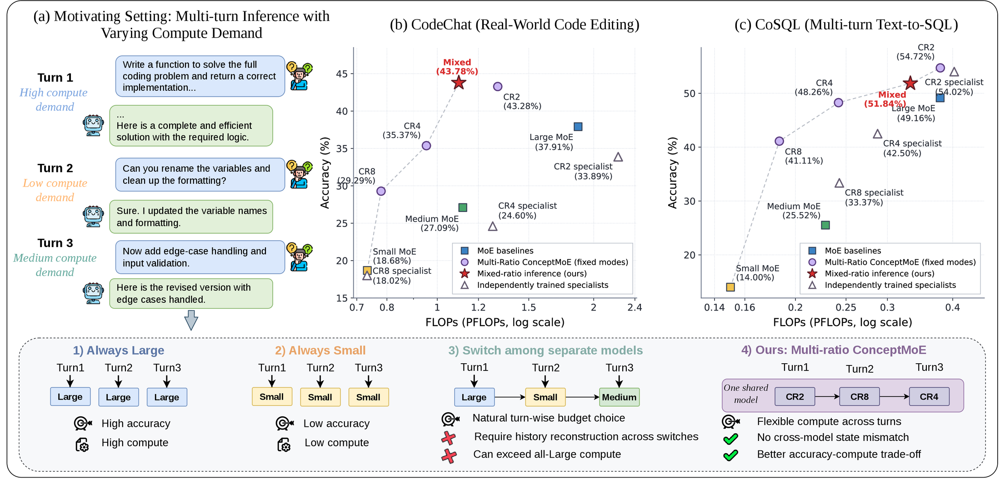
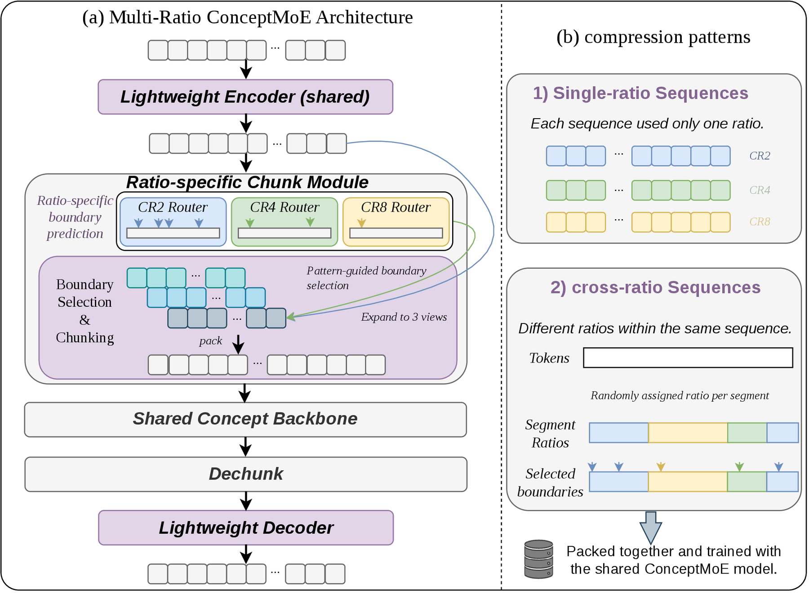
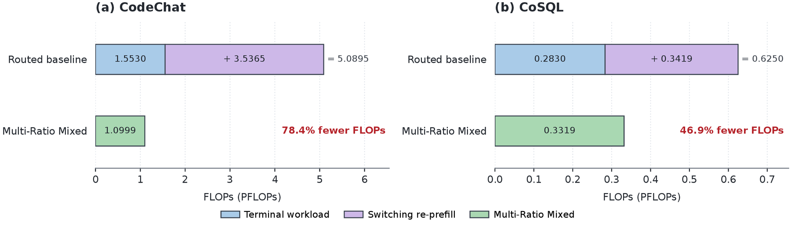
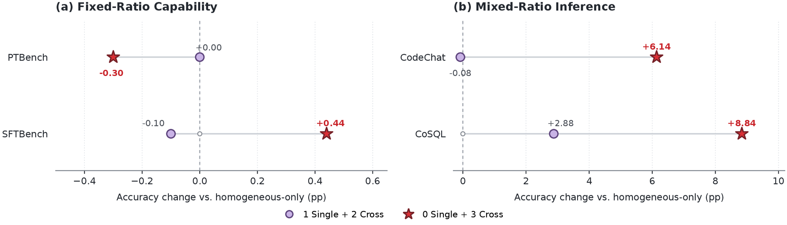

<div align="center">

<h1>One Model, Multiple Compute Budgets:<br>Multi-Ratio ConceptMoE for Flexible Compute Across Turns</h1>

<p><strong>Multi-Ratio ConceptMoE</strong></p>

<p>
  Yiyang Fu<sup>1,2,*</sup> &middot; Zihao Huang<sup>2</sup> &middot; Dongchen Han<sup>2,3,*</sup> &middot; Shukai Gong<sup>1</sup><br>
  Zhen Dong<sup>4</sup> &middot; Qiyang Min<sup>2,&dagger;</sup> &middot; Daquan Zhou<sup>1,&dagger;</sup>
</p>

<p>
  <sup>1</sup> Peking University &nbsp; <sup>2</sup> ByteDance Seed<br>
  <sup>3</sup> Tsinghua University &nbsp; <sup>4</sup> University of California, Santa Barbara
</p>

<p><sup>*</sup> Work done at ByteDance Seed &nbsp; <sup>&dagger;</sup> Corresponding authors</p>

<!-- Webpage URL remains blank until the public project page is available. -->
<p>
  <a href="https://arxiv.org/pdf/2610.14074"></a>
  <a href=""></a>
</p>

</div>

Official demo of **Multi-Ratio ConceptMoE**, extending [ConceptMoE](https://github.com/ZihaoHuang-notabot/ConceptMoE) to multiple compute budgets within a single shared model.

Multi-Ratio ConceptMoE jointly supports token-to-concept compression ratios of **2, 4, and 8**. Ratio-specific boundary routers and cross-ratio training allow different compression modes to coexist in the same context, enabling flexible compute allocation across interaction turns.



## 🔥 Highlights

- **One Model, Multiple Budgets**: One shared checkpoint supports CR2, CR4, and CR8, with lightweight full-token modules and a shared concept backbone.
- **Cross-Ratio Training**: Different segments use different compression ratios, preparing the shared model for mixed-ratio inference.
- **Strong Fixed-Ratio Performance**: All three modes outperform their compute-matched MoE baselines on both PTBench and SFTBench: **6 wins in 6 comparisons**.
- **Flexible Multi-Turn Compute**: Mixed-ratio inference improves accuracy while reducing FLOPs relative to the Large MoE on both CodeChat and CoSQL.

## 🧩 Overview

The shared encoder produces token representations once. Each ratio-specific router predicts candidate concept boundaries; each compression view selects boundaries according to its ratio assignment, with a forced boundary at every segment start. The concept backbone, DeChunk module, and decoder are shared across all ratios.



## 📊 Key Results

The following results and figures follow the trained models evaluated in [arXiv:2610.14074v1](https://arxiv.org/abs/2610.14074v1).

### Fixed-Ratio Performance

Each cell reports **MoE / Multi-Ratio ConceptMoE** accuracy (%). CR2, CR4, and CR8 are compared with the compute-matched Large, Medium, and Small MoE baselines, respectively.

| Compute budget | Compression mode | PTBench | SFTBench |
| :--- | :---: | :---: | :---: |
| High | CR2 | 31.7 / **32.1** | 19.0 / **21.5** |
| Medium | CR4 | 28.2 / **29.3** | 15.5 / **19.1** |
| Low | CR8 | 25.4 / **27.6** | 13.1 / **17.2** |

### Mixed-Ratio Inference

Mixed-ratio inference improves the accuracy-compute trade-off on both multi-turn tasks. Accuracy gains and FLOPs reductions below are relative to the **Large MoE**.

| Dataset | Mixed accuracy | Mixed FLOPs | Accuracy gain | FLOPs reduction |
| :--- | ---: | ---: | ---: | ---: |
| CodeChat | **43.78%** | 1.0999 PFLOPs | **+5.87 pp** | **41.1%** |
| CoSQL | **51.84%** | 0.3319 PFLOPs | **+2.68 pp** | **12.3%** |

CodeChat reports Combined Joint accuracy; CoSQL reports SQLite execution accuracy. FLOPs use the paper's terminal-turn workload protocol, including attention-map computation.

## 🚀 Switching Overhead

Under the **same turn-wise budget schedule**, Multi-Ratio ConceptMoE reduces FLOPs by **78.4% on CodeChat** and **46.9% on CoSQL** compared with routing among independent Large/Medium/Small models. The routed baseline includes history re-prefill after model switches; the shared model changes compression modes within the same backbone.



## 🔬 Cross-Ratio Training

Fully cross-ratio training improves mixed-ratio inference by **6.14 points on CodeChat** and **8.84 points on CoSQL** over homogeneous-only training, while largely preserving fixed-ratio capability.



## Quick Start

```bash
python3 -m pip install torch einops
python3 MultiConceptMoE_demo.py
```

The single-file demo retains the original ConceptMoE structure and placeholder attention/MoE layers. It demonstrates both fixed-ratio and mixed-ratio views:

```python
logits, aux_loss = model(input_ids)                 # CR2 / CR4 / CR8 views
logits, aux_loss = model(input_ids, mixed_cr=True)  # three mixed-ratio views
```

The example returns logits shaped `[3, 64, 128]` and a summed compression auxiliary loss. It uses random weights to illustrate multi-ratio routing; it does not reproduce the paper's results or implement inference caches. Views run separately with shared weights, and target compression ratios are learned through the auxiliary loss.

## 📝 Citation

```bibtex
@misc{fu2026multiratio,
  title={One Model, Multiple Compute Budgets: Multi-Ratio ConceptMoE for Flexible Compute Across Turns},
  author={Fu, Yiyang and Huang, Zihao and Han, Dongchen and Gong, Shukai and Dong, Zhen and Min, Qiyang and Zhou, Daquan},
  year={2026},
  eprint={2610.14074},
  archivePrefix={arXiv},
  primaryClass={cs.LG},
  url={https://arxiv.org/abs/2610.14074}
}
```

## Acknowledgements

This demo builds on [ConceptMoE](https://github.com/ZihaoHuang-notabot/ConceptMoE).
